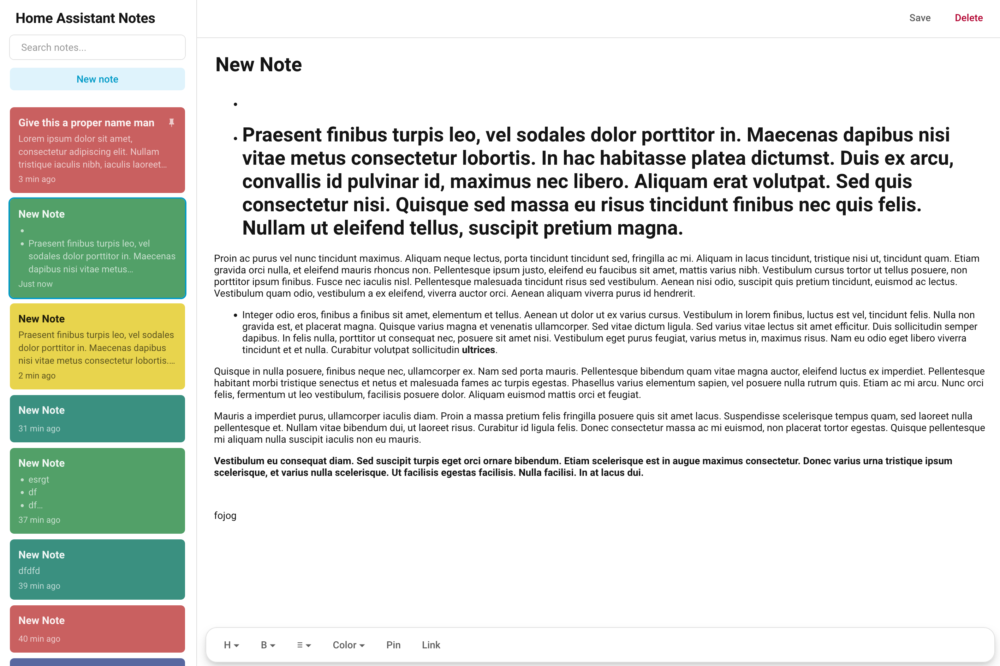
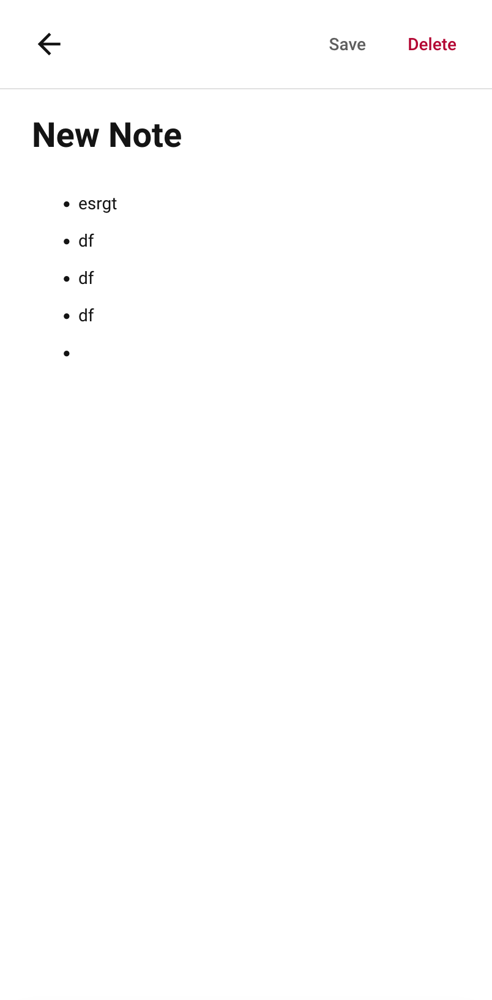

# Home Assistant Notes

**Home Assistant Notes** is an Apple Notes-style notepad for Home Assistant: a full-page sidebar panel with a rich text editor, checklists, colored sticky notes, and a Lovelace card to show notes on any dashboard. Use it for shopping lists, household notes, or reminders the whole family can see, without leaving Home Assistant. Works on desktop, phone, and wall tablets, in light and dark mode.

[](https://my.home-assistant.io/redirect/hacs_repository/?owner=dimac-h&repository=Home-Assistant-Notes&category=integration)
[](https://my.home-assistant.io/redirect/config_flow_start/?domain=home_assistant_notes)

<table>
<tr>
<td></td>
<td></td>
</tr>
</table>

## Features

- Rich text editing via [Tiptap](https://tiptap.dev/) headings, bold, italic, lists, checklists, highlights, links and code
- Ten note colors with pin support
- Real-time search
- Dashboard card to display notes on any view with filter and configuration options
- Auto-save
- Dark mode

## Installation

### Marketplace (recommended)

[](https://github.com/hacs/integration)

Find *Home Assistant Notes* under **Settings → Marketplace** (formally HACS) or use the button below.

[](https://my.home-assistant.io/redirect/hacs_repository/?owner=dimac-h&repository=Home-Assistant-Notes&category=integration)

### Manual

Download `home_assistant_notes.zip` from the [latest release](https://github.com/dimac-h/Home-Assistant-Notes/releases/latest), unzip it into `custom_components/home_assistant_notes` in your HA config directory, and restart. (Copying the folder straight from the repository won't work: the built frontend is only included in release zips.)

### Setup

Go to **Settings → Devices & Services → Add Integration** and search for *Home Assistant Notes*, or click the shortcut button below. The panel appears in the sidebar automatically.

[](https://my.home-assistant.io/redirect/config_flow_start/?domain=home_assistant_notes)

## Actions

The integration provides eight actions (services): four for notes and four for the spellcheck word lists. They are available in the Actions picker, automations, scripts and Developer Tools.

| Action | Fields | Returns |
|---|---|---|
| `home_assistant_notes.create_note` | `title` (required), `content`, `color` (hex, default `#FFEB3B`), `pinned`, `tags` | The created note (optional response) |
| `home_assistant_notes.update_note` | `note_id` (required), `title`, `content`, `color`, `pinned`, `tags` | Nothing. Fails if the note doesn't exist |
| `home_assistant_notes.delete_note` | `note_id` (required) | Nothing. Fails if the note doesn't exist |
| `home_assistant_notes.get_notes` | none | `{ notes: [...] }` (response only) |
| `home_assistant_notes.add_dictionary_word` | `lang` (required), `word` (required) | Nothing. Adds a word to the personal dictionary of one language |
| `home_assistant_notes.remove_dictionary_word` | `lang` (required), `word` (required) | Nothing |
| `home_assistant_notes.add_ignored_word` | `word` (required) | Nothing. Adds a word to the ignore list (all languages) |
| `home_assistant_notes.remove_ignored_word` | `word` (required) | Nothing |

Each action also fires an event you can use as an automation trigger: `home_assistant_notes_note_created`, `home_assistant_notes_note_updated` (the note is attached) and `home_assistant_notes_note_deleted` (carries `note_id`). Changes to the word lists fire `home_assistant_notes_words_changed`, and changing the spellcheck languages fires `home_assistant_notes_spellcheck_changed`.

```yaml
action: home_assistant_notes.create_note
data:
  title: Shopping list
  content: Milk, eggs, bread
  color: "#FF9800"
  pinned: true
  tags: [shopping]
response_variable: new_note
```

```yaml
action: home_assistant_notes.get_notes
response_variable: result   # result.notes is a list of note objects
```

## Formatting toolbar

| Button  | Action                                                 |
|---------|--------------------------------------------------------|
| **H▾**  | Heading level (Normal / H1 / H2 / H3)                  |
| **B▾**  | Bold, Italic, Strikethrough, Highlight, Code, Code block, Blockquote |
| **≡▾**  | Bullet list, Numbered list, Checklist, Indent, Outdent |
| **🎨▾** | Note color                                             |
| **📌**  | Pin / unpin                                            |
| **🔗**  | Insert / remove link                                   |
## Spellcheck

The note body is spellchecked while you type. Misspelled words get a wavy underline in the error color of your theme.

- **Languages per paragraph.** The language is detected for each paragraph or list item, so a note can mix two languages. Very short lines take the language of the line before them.
- **Suggestions.** When the caret is in a misspelled word, a strip appears above the toolbar with suggestions, **Add to dictionary** and **Ignore**. Tap a suggestion to replace the word.
- **Language chip.** The first item in the toolbar shows the language of the current paragraph. Use it to switch that paragraph between the two configured languages, or choose **Don't check** to turn spellchecking off for the whole note. A chip that says "Off" has a **Check spelling** entry to turn it back on.
- **Title.** The title field is not checked by this feature. It keeps the browser's own spellcheck.

### Choosing the two languages

Go to **Settings → Devices & services → Home Assistant Notes → Configure** and pick two languages. By default these are the language of your Home Assistant plus English. A change applies right away; you don't need to reload anything.

The dictionaries are downloaded once by Home Assistant itself from the jsdelivr npm CDN and then served from your own instance. No note text ever leaves your device. Only the dictionary files are downloaded.

Your personal dictionary (per language) and your ignore list are stored in Home Assistant, so they are shared across all your devices.

Supported languages (17): English, Nederlands, Türkçe, Français, Deutsch, Español, Português, Italiano, Ελληνικά, Svenska, Norsk bokmål, Magyar, Română, Русский, Polski, עברית, 한국어.

### Dictionary licenses

The dictionaries are the npm `dictionary-<code>` packages (Hunspell dictionaries). They are downloaded at runtime from the CDN. This integration does not bundle or redistribute them. Each one has its own license:

| Language | Package | License | Unpacked size |
|---|---|---|---|
| English | `dictionary-en@4.0.0` | MIT AND BSD | 0.6 MB |
| Nederlands | `dictionary-nl@2.0.0` | BSD-3-Clause OR CC-BY-3.0 | 2.6 MB |
| Türkçe | `dictionary-tr@2.0.0` | MIT | 9.4 MB |
| Français | `dictionary-fr@3.0.0` | MPL-2.0 | 1.4 MB |
| Deutsch | `dictionary-de@3.0.0` | GPL-2.0 OR GPL-3.0 | 1.1 MB |
| Español | `dictionary-es@4.0.0` | GPL-3.0 OR LGPL-3.0 OR MPL-1.1 | 0.9 MB |
| Português | `dictionary-pt@4.0.0` | LGPL-3.0 OR MPL-2.0 | 5.5 MB |
| Italiano | `dictionary-it@2.0.0` | GPL-3.0 | 1.4 MB |
| Ελληνικά | `dictionary-el@4.0.0` | GPL-2.0 OR LGPL-2.1 OR MPL-1.1 | 19.4 MB |
| Svenska | `dictionary-sv@4.0.0` | LGPL-3.0 | 2.4 MB |
| Norsk bokmål | `dictionary-nb@3.0.0` | GPL-2.0 | 5.4 MB |
| Magyar | `dictionary-hu@3.0.0` | GPL-2.0 OR LGPL-2.1 OR MPL-1.1 | 3.9 MB |
| Română | `dictionary-ro@3.0.0` | GPL-2.0 OR LGPL-2.1 OR MPL-1.1 | 2.3 MB |
| Русский | `dictionary-ru@3.0.0` | BSD-3-Clause | 3.6 MB |
| Polski | `dictionary-pl@2.0.0` | GPL-3.0 OR LGPL-3.0 OR MPL-2.0 | 5.0 MB |
| עברית | `dictionary-he@2.0.0` | AGPL-3.0 | 5.8 MB |
| 한국어 | `dictionary-ko@2.0.0` | GPL-2.0 OR LGPL-2.1 OR MPL-1.1 | 14.0 MB |

## Use cases

- **Shared shopping list**: a checklist note on the kitchen tablet dashboard that everyone can tick off.
- **Household notes**: Wi-Fi password, bin collection days, the plumber's number, pinned to the top.
- **Wall-tablet sticky notes**: color-coded notes via the Lovelace card, always visible on the dashboard.
- **Automation-driven notes**: create or update notes from automations with the `home_assistant_notes.create_note` and `home_assistant_notes.update_note` services.

## FAQ

**Where are my notes stored?** Locally in your Home Assistant `.storage` folder (`home_assistant_notes.notes`). Notes are included in the regular Home Assistant backups.

**Do notes sync between devices?** Yes. Every device opening the panel or card reads from the same Home Assistant storage, so it works across phones, tablets, and desktops.

**Can I show a note on a dashboard?** Yes, add the `custom:home-assistant-notes-card` card to any view.

**Home Assistant version required** 2026.11.0 or newer.

**Can I use notes in automations?** Yes. The `create_note`, `update_note`, `delete_note`, and `get_notes` services are available in the Actions picker and in YAML.

## Troubleshooting

**Panel not in sidebar** — disable and re-enable the integration in Settings → Devices & Services, then hard-refresh the browser.

**Card is not loading** — check the browser console for errors. The card type is `custom:home-assistant-notes-card`.

## Removing the integration

1. Go to **Settings → Devices & Services**, open **Home Assistant Notes**, and choose **Delete** from the ⋮ menu. The sidebar panel and the actions disappear immediately.
2. Remove any `custom:home-assistant-notes-card` cards from your dashboards.
3. Optional: uninstall the files via the Marketplace (or delete `custom_components/home_assistant_notes`) and restart.

The notes remain in `.storage/home_assistant_notes.notes` after removal, so you have to manually remove them through the file editor

## License

MIT — contributions are welcome via [pull request](https://github.com/dimac-h/Home-Assistant-Notes/pulls).

If Home Assistant Notes is useful to you, please consider giving it a ⭐ on GitHub. It helps other Home Assistant users find it. Questions and ideas are welcome in [Discussions](https://github.com/dimac-h/Home-Assistant-Notes/discussions).
